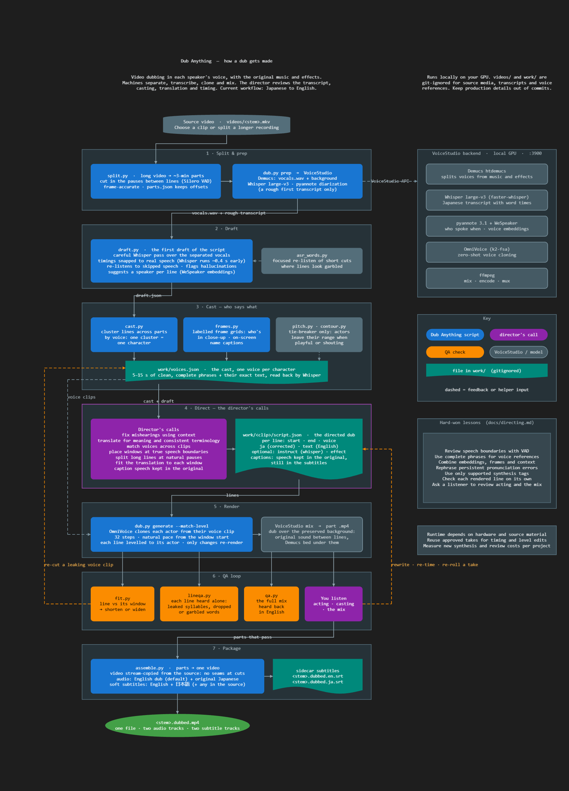

# dubrama

Dub video into another language **in each actor's own voice**, keeping the
original music and sound effects. Everything runs locally on your GPU. Built and
tested for **Japanese → English**, **Spanish → English** and **English →
Japanese** on Windows with an NVIDIA GPU. Other language pairs and hardware need changes in a few known
places, a job you can hand your coding agent: see
[Other languages and hardware](#other-languages-and-hardware).

## What's different

Most dubbing tools run a fixed pipeline: transcribe, translate, clone each
speaker from one clip, speed up whatever runs long. dubrama differs where a
listener notices:

- **An agent directs, line by line.** It casts each line from speaker
  embeddings, frames and the dialogue, fixes what Whisper misheard from context,
  writes the translation timed to the actor, and triages every QA flag. It tells you
  which lines are guesses instead of hiding them.
- **Each line acts like the original.** The voice is prompted with the actor's
  own delivery of that line, not one clip per character, so a shout stays a
  shout and a murmur a murmur. A line whose window holds another voice falls
  back to the character's usual reference, so nothing leaks in.
- **Each line takes the actor's time.** Every take is re-timed to end where the
  actor stops, so turns land where they did in the original instead of leaving
  dead air. Each take's length is predicted before the first render, so the
  translation is written to fill the time.
- **Every line is checked.** Each rendered line is transcribed back; a garbled
  one gets fresh takes, up to three rounds, and the best is kept.
- **It reads the picture.** Burned-in closed captions become the transcript
  (and often name the speaker), and text on screen can be translated as placed
  subtitles.
- **Chosen by ear.** The defaults were picked by listening to the alternatives
  side by side against the original; what was measured is in
  [docs/research.md](docs/research.md).

## How you use it

You don't run the scripts yourself. Open this folder in an AI coding agent
(Claude Code, Codex, Cursor or another harness that reads
[AGENTS.md](AGENTS.md)) and ask it to dub a video. The agent directs the dub,
and `AGENTS.md` tells it how:

- **The scripts** do the heavy lifting: separate voices from music, transcribe,
  clone, mix, and check every line.
- **The agent** makes the calls: who says what, what Whisper misheard, a natural
  translation timed to the actor's lips, what stays in the original, which QA
  flags are real. It tells you which lines are guesses.
- **You** listen. You judge the acting, the voices and the mix, and decide what
  may be cloned or shared.

In practice:

1. Set up once: [docs/setup.md](docs/setup.md).
2. Ask, for example: *"Dub D:\movies\my-show.mkv."* (or *"Dub it into
   Japanese"* for an English video).
3. Answer one question: which voice, or both (below). Into Japanese there is
   only the actor's voice.
4. Wait. The agent tells you if something needs you, and at the end gives you
   a list of moments to listen to. Say what to change.
5. Watch the result: your file itself, renamed `my-show (dubbed).mkv`. The
   dub plays by default (the actor's voice when you chose both), the original
   audio is the last track, and subtitles in both languages are included.

## The one choice: the voice

| | **Actor's voice** (default) | **American** |
|---|---|---|
| Sounds like | The actor speaking English, with their own accent | Native American English, converted towards each actor's voice |
| Best for | Live action | Anime and animation |
| Trade-off | Accented English | Less like the actors on live action, and a little less of the acting; about 4× slower to render |

Not sure? Ask for both: each gets its own audio track, and you switch between
them in the player. Everything else (separation, timing, voice processing) has
defaults chosen by ear.

Dubbing English into Japanese, the actor's voice is the only one: each actor
speaks Japanese with their own (English) accent. There is no native-Japanese
counterpart of the American voice yet.

## How it works



1. **Split** long videos into ~3-minute parts at pauses in speech.
2. **Separate** the voices from music and effects (Mel-Band Roformer).
3. **Transcribe** the original (Whisper large-v3, with two other recognisers as a
   second opinion). If the picture has burned-in closed captions, they are read
   too: the exact words, often with the speaker's name.
4. **Direct** (the agent): cast each line, correct the transcript, translate,
   and time every line to the actor → `work/<part>/script.json`.
5. **Voice** each line. With the actor's voice, OmniVoice clones the actor
   (in English or Japanese), prompted with their own delivery of that line. With American, IndexTTS
   speaks native English following the actor's delivery, and Chatterbox then
   converts it to the actor's voice.
6. **Fit, mix and check.** Each take is re-timed to end where the actor stops
   and mixed over the original background; every line is transcribed back to
   catch garbled words.

Outside the dubbed lines you hear the original soundtrack, so songs, laughs and
names stay the actor's own. The diagram is [docs/process.jg](docs/process.jg), a
[Jumpgate](https://github.com/swax/jumpgate) file. It is rendered with
`npm run render -- <path>/docs/process.jg` from Jumpgate's `packages/jumpgate`.

## Other languages and hardware

Three language pairs are built and tested, Japanese → English, Spanish →
English and English → Japanese, on Windows with an NVIDIA GPU. The voice engine isn't the limit:
VoiceStudio clones voices in hundreds of languages and runs on macOS and Linux
too. Each part records its pair when it's prepared (`dub.py prep --source en
--target ja`), and the scripts read it from there; `PAIRS` in `scripts/core.py`
lists the pairs they know. Another pair needs work in these places:

- **The source language.** Whisper transcribes any language, and each line
  keeps its transcript in a field named for it (`ja`, `en`, `es`). The stock
  hallucinations `draft.py` watches for are listed per language, and the
  second opinions (`second.py`: ReazonSpeech and SenseVoice for Japanese,
  Parakeet and SenseVoice for English, Parakeet v3 and Canary for Spanish)
  and the caption OCR (`subs.py`, a Chinese and Japanese model that reads
  Latin letters but not always their accents) know only some languages.
  Another source language needs models that know it, or goes without these
  checks. `draft.py` checks Whisper's language detection against its
  confidence, since it mistakes a language close to the target's sound
  (short Spanish over music) for the target.
- **The target language.** Rendered lines are transcribed back and compared
  word by word in English and by their kana reading in Japanese (`lineqa.py`,
  `kana.py`); another language needs its own normalization. Take lengths come
  from OmniVoice's own rule, with corrections measured on Japanese → English
  takes. Track and subtitle names are listed per language (`TITLES` in
  `core.py`), and the American voice is English by design.
- **The directing notes.** [docs/directing.md](docs/directing.md) was written
  from Japanese → English dubs, with sections on what differs dubbing English
  into Japanese and Spanish into English. Most of it is about casting, timing
  and QA and carries over.
- **Hardware.** The models run on CUDA and mostly fall back to the CPU without
  it, much slower. Video is encoded with NVENC when it's there, else x264. The
  Windows-only parts (starting the backend, the GPU lock, a cuDNN workaround)
  already check the platform, so Linux with an NVIDIA GPU should be the
  shortest port.

## Doing it by hand

With VoiceStudio's Python (`$py = "C:\git\VoiceStudio\.venv\Scripts\python.exe"`),
`scripts/dubrama.py` runs the machine work of a whole dub; you write the scripts:

```powershell
& $py scripts\dubrama.py new D:\movies\my-show.mkv --voices both   # a job named my_show
& $py scripts\dubrama.py run my_show --watch     # split, prep, draft; render each part you mark ready; deliver
# write work\my_show-NN\script.json for each part, then:
& $py scripts\dubrama.py ready my_show 01
& $py scripts\dubrama.py status my_show
```

Or step by step, with the backend running (`scripts/backend.py start`):

```powershell
& $py scripts\split.py videos\episode.mkv                      # long video -> parts at pauses
& $py scripts\dub.py prep videos\episode-parts\episode-01.mp4  # upload, separate, transcribe
& $py scripts\draft.py episode-01                              # careful transcript, suggested cast
# write work\episode-01\script.json and the cast in work\voices.json
& $py scripts\dub.py generate episode-01 --match-level         # clone, time, mix, export
& $py scripts\lineqa.py episode-01                             # check each rendered line
& $py scripts\assemble.py episode --parts 1-4                  # one video with both audio tracks
& $py scripts\deliver.py D:\movies\episode.mkv actor=videos\episode-parts\dubbed\episode.dubbed.mp4
```

Some steps need their own environments (`separate.py`, `subs.py`, `second.py`;
see [AGENTS.md](AGENTS.md)). The workflow, the script format, every tool and the
gotchas are in [docs/directing.md](docs/directing.md). What was measured and
tried is in [docs/research.md](docs/research.md), and what's next is in
[docs/roadmap.md](docs/roadmap.md).

## Responsible use

Only dub media you have the rights to, and only clone voices with the consent
the use requires. Output made from someone else's film or voice is for private
use unless you have permission. `videos/` and `work/` are git-ignored, so source
media, transcripts and voice references stay out of commits: don't force-add
them, and use invented examples in docs and commit messages.

## License

dubrama is MIT-licensed ([LICENSE](LICENSE)). It talks to
[VoiceStudio](https://github.com/debpalash/VoiceStudio) over HTTP and does not
include its code. VoiceStudio is AGPL-3.0, and so is
`patches/voicestudio-local-fixes.patch`, a change to VoiceStudio's source. Models have
their own licenses:
- pyannote is gated on Hugging Face;
- the Sortformer weights are CC-BY-NC;
- Chatterbox (the American voice's converter) is MIT, and marks its output with
  an inaudible watermark.

Check each model before commercial use. Nothing is uploaded anywhere; Hugging
Face is only used to download models.
