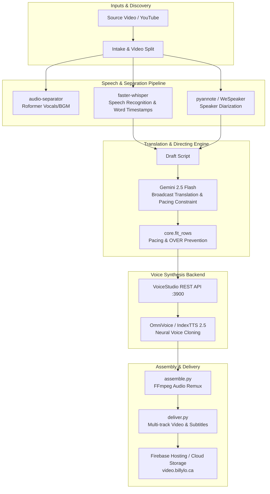

# Dub Anything Architecture

Dub Anything is an automated AI dubbing pipeline that turns machine transcripts into directed dialogue, fits speech into character windows, and renders cloned voices.

## System Architecture

## Runtime Environments

Dub Anything supports three deployment topologies:

### 1. Local macOS (Apple Silicon Metal / MPS)
- **Acceleration**: Apple Metal (`mps` device) via PyTorch Metal backend.
- **Backend**: Electron-bundled or source VoiceStudio running on `127.0.0.1:3900`.
- **Paths**: `~/Library/Application Support/OmniVoice`, `~/Library/Caches/OmniVoice`.
- **Automation**: macOS `launchd` plist (`ca.billylo.auto-dub-ctv.plist`).

### 2. Local / Workstation Linux (NVIDIA CUDA)
- **Acceleration**: NVIDIA CUDA 12.8 / cu128 PyTorch wheels.
- **Backend**: Headless Uvicorn process managed by `scripts/backend.py`.
- **Paths**: `~/.local/share/OmniVoice`, `~/.cache/OmniVoice`.

### 3. Google Cloud Run Jobs (Headless Serverless GPU)
- **Container**: Ubuntu 22.04 LTS + CUDA 12.8 (`Dockerfile`).
- **Hardware**: 1 $\times$ NVIDIA L4 GPU (24 GB VRAM), 4 vCPUs, 16 GiB RAM.
- **Model Storage**: Persistent Cloud Storage bucket (`gs://videos-billylo-models`) mounted via Cloud Storage FUSE at `/models`.
- **Secrets**: Injected via Google Cloud Secret Manager (`GEMINI_API_KEY`).
- **Scheduling**: Google Cloud Scheduler triggering the Cloud Run Job daily.
- **Publishing**: Direct deployment to Firebase Hosting (`--project videos-billylo`).
